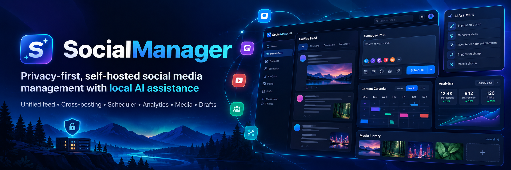

# SocialManager

Self-hosted social media management for separate brands and workspaces. The UI supports English and Turkish. The application uses Vue 3, Fastify 5 on Node 24, MongoDB 7, Redis/BullMQ, and Nginx.

Connect Claude or ChatGPT through the built-in Model Context Protocol (MCP) server to automate social media workflows from a conversation. Ask your assistant to read your brand context, create and save content plans, write or revise batches of drafts, select uploaded media and connected accounts, and prepare posts for scheduling or immediate publishing. With the required permissions and your explicit confirmation of each publishing or scheduling preview, the assistant can execute delivery and check the results. Content is written in your Claude or ChatGPT conversation, so this workflow needs no separate text-generation API key. See [Claude and ChatGPT connectors (MCP)](#claude-and-chatgpt-connectors-mcp) for setup.

## Supported integrations

Facebook Pages, linked professional Instagram accounts, Twitter/X, Mastodon, Bluesky, Pinterest, and TikTok have publishing adapters. Provider permissions, account type, and media accessibility still apply. LinkedIn, Reddit, and YouTube are unavailable and hidden from connection/publishing choices. Their old source is retained for reference; their containers are not part of production.

Twitter/X, Mastodon, and Bluesky currently publish text only. Requests with media are rejected rather than dropping attachments. Instagram requires an image or video; TikTok requires a video. Pinterest needs an image and a board. Facebook supports text, links, images, and videos. A timeout can leave a provider outcome uncertain: check the account before resending. The UI preserves failed destinations and shows per-account results.

## Run with Docker

1. Copy `.env.example` to `.env` and set `APP_BASE_URL` to the URL registered with your providers.
2. Generate and privately store a 32-byte encryption key:

   ```sh
   node -e "console.log(require('crypto').randomBytes(32).toString('hex'))"
   ```

   Set `ENCRYPTION_KEY` to the resulting 64 hexadecimal characters. An invalid key prevents startup. Preserve this key with backups; changing it without migrating encrypted credentials makes them unreadable.
3. Run `docker compose build` then `docker compose up -d`.
4. Open `http://localhost:8081` and configure accounts in Settings and AI providers in Global Settings.

Production images contain application code and locked dependencies. The UI serves compiled assets with Nginx, without the Vite development server. Rebuild changed services to apply source or dependency changes. Nginx resolves container names through Docker DNS so service recreation does not leave stale upstream IPs.

Persistent data resides in `mongodb-data`, `redis-data`, and `media_uploads`. Redis enables append-only persistence. Backend health checks use `/health`. Scheduler shutdown allows 150 seconds for active deliveries. Do not delete volumes during normal updates.

## Facebook and Instagram discovery

Select the intended workspace before connecting Meta. OAuth uses a short-lived, one-time state bound to that workspace. Discovery follows paginated Page listings and accessible business portfolios. It persists pending selections across reloads.

Meta can omit a Page from its account listing even when a direct lookup is authorized. In **Choose Pages & Accounts to Connect**, use **Find Page** with its Facebook URL or numeric Page ID, then select the Page and linked Instagram account and click **Connect Selected**. Refresh fetches discovery again. Permission errors appear as warnings; refresh cannot grant missing Meta permissions. Instagram must be a professional account linked to the Facebook Page.

In Settings, **Refresh available accounts** and reconnecting also update pictures and tokens for saved accounts in the active workspace, preserving their selections. New accounts still require **Connect Selected**. Saved accounts remain visible when a health check fails or all accounts are deselected; unavailable pictures show the platform icon.

## Content planning

Content Plan includes an optional campaign context box (up to 20,000 characters). Add the feature to highlight, campaign goals, or numbered text for an introduction series. This context accompanies both brief generation and every platform’s post generation, remains in the recoverable background job, and is saved with the calendar. Changing campaign inputs clears a previously reviewed brief so the next approval uses the current context. Model output should still be reviewed before publishing.

Compose includes **Create a Reel from images**: arrange up to 12 workspace images, edit scene text and timing, choose padding or cropping and cut/fade transitions, and optionally add an uploaded soundtrack you have permission to use. Rendering runs as a recoverable background job, exports 1080 × 1920 H.264/AAC video, and saves the result in the Media Library. Preview the finished video before attaching it; rendering never publishes. Failed renders can retry saved scene checkpoints, and active renders can be cancelled. Content Plan also carries the selected Instagram format into generated posts and drafts. Generative video providers and Facebook-specific shorts remain in [the product roadmap](ROADMAP.md).

## Claude and ChatGPT connectors (MCP)

Connect SocialManager to Claude conversations using your Claude account. Claude writes the content in the conversation and calls SocialManager tools to save it. This workflow does not use an Anthropic text-generation API key. Organisation/compliance-management credentials are not generation credentials.

Server setup:

1. Run `node scripts/configure-connector.cjs --url https://your-manager-domain.example/mcp`. It writes a salted password hash to the ignored `.env` and a generated password to the ignored `.connector-owner-password` file. The password is not printed. Use `--secret-file /private/path` to store it elsewhere, or `--rotate` to change it and invalidate existing connector-owner browser sessions.
2. Rebuild and start the connector, gateway, UI, and proxy: `docker compose build connector gateway ui`, then `docker compose up -d connector gateway ui`. Recreate Nginx after updating its bind-mounted configuration: `docker compose up -d --no-deps --force-recreate nginx`.
3. Open Global Settings → Claude app connector. Add the displayed URL as a custom connector in Claude. Use OAuth and **Register automatically** when prompted for the OAuth client registration method.
4. Sign in with the connector owner password, select the workspaces, and approve the requested permissions. Reading/drafts are selected by default; publishing and scheduling are explicit additional permissions.

Use your deployment's public HTTPS domain, for example `https://your-manager-domain.example/mcp`. Retrieve the connector owner password from the private file written by the configuration command (or your chosen `--secret-file` location); do not paste it into a chat or commit it.

The connector supports reading brand profiles, connected destinations, uploaded media, plans, drafts, and scheduled-post history; saving plans and draft batches; editing existing drafts; and optionally preparing and executing publishing/scheduling previews. A post preview binds the exact content, accounts, media, workspace, and time. The chat app must present it and obtain explicit user confirmation before calling the execution tool. Completed results are cached; a lost dispatch response remains uncertain and requires checking the account or Scheduler before making another submission. The connector never silently retries an uncertain public post.

To revise an existing draft, use `list_drafts` to identify it, then `get_draft` and `update_draft` with the returned `updatedAt` as `expectedUpdatedAt`. Send only changed fields: text, first comment, workspace Media Library attachment, selected destinations, or a planned date (`YYYY-MM-DDTHH:mm` as shown in Compose). Omitted fields stay unchanged; empty strings clear optional fields and an empty destinations array clears account selections. Updates keep the same draft ID and work for app-created drafts too. Reuse the same `requestId` and arguments on retries. A conflict requires rereading the latest draft. The existing draft permission covers editing for Claude, ChatGPT and the local assistant; a planned date never queues a public post or modifies an already scheduled delivery.

Only media already uploaded to the authorised workspace may be used by connector posting tools. OAuth access tokens expire after one hour, refresh tokens rotate, grants expire after 30 days, and replaying a used refresh token revokes its grant. Revoke connections immediately at `/connector`. Tokens/codes/browser sessions are hashed at rest; OAuth client secrets are encrypted. Connector authorization does not change the app's existing authentication or network access model.

In **Content Plan**, choose the month/platforms, enter campaign context, and click **Copy Claude prompt**. Paste it into Claude with the connector enabled. Claude can save its plan and return a workspace-specific link. Open it from **Saved plans** or the returned link. The other Generate buttons continue to use the configured API/local provider; MCP does not turn a Claude chat subscription into an automatic server-side generation API.

The endpoint uses the official MCP SDK with Streamable HTTP, OAuth discovery, PKCE, dynamic client registration, and revocation. Remote clients require internet access to the HTTPS URL. No additional host port is published. Configure the existing external proxy to preserve `Authorization`, `Accept`, and MCP headers and route `/mcp`, `/connector`, `/authorize`, `/token`, `/register`, `/revoke`, and the OAuth `/.well-known/` paths to this stack. This deployment's Nginx configuration includes those routes.

### ChatGPT plugin setup

ChatGPT uses the same MCP endpoint and owner password as Claude, with a separate OAuth approval. No OpenAI generation API key is needed for this conversation workflow.

1. Open **Plugins** in ChatGPT. Menus differ across surfaces/accounts. If **+ → Add custom MCP server** is present, enter your MCP URL, for example `https://your-manager-domain.example/mcp`, and choose **OAuth** with **DCR**; leave static client credentials blank.
2. If the + menu shows **Create plugin / Upload plugin**, download the package from **Global Settings → OpenAI / ChatGPT → Download ChatGPT plugin ZIP**, or directly from `/connector/chatgpt-plugin.zip`. Use **Upload plugin**, then inspect its **SocialManager MCP connection**. The ZIP declares the endpoint and OAuth/DCR settings and contains no credentials. This package follows OpenAI's documented portable plugin format; acceptance and MCP linking in the owner's account still need verification. A successful upload that only creates instructions does not establish a connection.
3. Complete the OAuth connection in your browser using the existing connector owner password, select workspaces/permissions, then install/select the plugin with **@** in a new chat. Publishing/scheduling remain optional. If the MCP connection is absent or the upload is rejected, keep the exact error and check custom MCP permissions/availability with the workspace administrator or OpenAI support. **Create plugin** opening Plugin Creator is the documented workflow-authoring path and does not prove that a custom MCP server can be registered from that conversation. Do not paste the owner password into Plugin Creator.

4. In SocialManager **Content Plan**, select the month/platforms and campaign context, then click **Copy ChatGPT prompt**. Paste it into ChatGPT with SocialManager selected. Open the returned plan link or use **Saved plans** afterwards. **Copy Claude prompt** remains available for Claude.

Each chat app receives its own grant and tokens. Revoking ChatGPT at `/connector` leaves other grants active. Approved tools cover the same context, plans, drafts, uploaded media, and optional confirmed publishing/scheduling as Claude. The server validates workspace and scope permissions on every request; the ChatGPT origin does not authorize owner form submissions. The OAuth callback URI is supplied by ChatGPT during registration, including callback-specific paths; the server binds codes to that exact URI and uses PKCE.

See OpenAI's [custom MCP plugin setup](https://developers.openai.com/api/docs/guides/custom-mcp-server), [OAuth authentication](https://developers.openai.com/plugins/build/auth), and [tool metadata reference](https://developers.openai.com/plugins/reference). UI labels and availability can vary by ChatGPT workspace. This adds a custom plugin for your account/workspace; it does not publish SocialManager to the public plugin directory. Other app Generate buttons continue to use the configured API/local provider.

### Local Ollama assistant

Open **Local assistant** in SocialManager (or Global Settings → Local models and connectors → Open local assistant). Sign in with the existing connector owner password, approve permissions for the selected workspace, and start a session. Read/drafts are selected by default. The selected Ollama model must advertise tool support; the app checks `/api/show` before starting. Configure its endpoint and model in the local group in Global Settings. The local assistant uses that Ollama configuration even when another generation provider is active; it never falls back to cloud inference.

The assistant is an MCP client connected to the same SocialManager tool server using the official SDK's in-process transport. It can read brand context and account destinations, save plans and drafts, and optionally prepare publishing/scheduling previews. The model cannot invoke the execution tool: a real button click in the app is required to dispatch the bound preview. Review the exact text, accounts, media and timestamp before confirming. Delivery results and uncertain outcomes remain visible; retries reuse the preview's stored outcome.

Conversations and tool progress are saved per workspace and connector-owner browser session, and expire within eight hours. Leaving/reopening the page resumes polling an active turn. Restarting the connector marks interrupted turns as failed without silently repeating generation or delivery; check Drafts, Saved plans or Scheduler for any completed actions. A conversation has bounded steps, tool calls and context size. Start a new session when full. Revoking its local grant at `/connector` blocks subsequent actions. Workspace deletion removes its saved conversations.

Other Ollama chat clients can use the shared remote `/mcp` endpoint when they implement MCP Streamable HTTP with OAuth/DCR; Ollama's model API itself is not an MCP client. The built-in assistant supplies that client and tool loop. See [Ollama tool calling](https://docs.ollama.com/capabilities/tool-calling) for the underlying model protocol. Model quality still affects whether requests and saved text meet expectations.

Global Settings groups Claude's API/connector, OpenAI's API/ChatGPT plugin/image readiness, local Ollama/assistant/compatible endpoints/local images, Google/Gemini/Places, other AI providers, and social platform apps. Image settings save only fields for their own provider, preserving edits in other groups. Existing connector deep links remain available.

## AI configuration

Image creation exports exact dimensions: static Instagram artwork defaults to 3:4 (1080 × 1440), while Stories and Reel artwork use 9:16 (1080 × 1920). Generated originals stay in the workspace Media Library. Review the prepared image before attaching it; choose whole-image fitting with white padding or an explicit crop. Attached images also have a dimension preparation tool. A separately selected 4:5 export is available for API compatibility; the 3:4 original is preserved.

Ollama, Anthropic Claude, OpenAI, Groq, Gemini, and OpenAI-compatible endpoints are supported. Image generation supports the configured OpenAI, Gemini, xAI, or local image server. Keys are encrypted in MongoDB. A saved key or installed SDK does not prove that a provider accepts the credential: test with a real request. Provider authentication and stream errors are surfaced to the UI. Each configured cloud provider has a live Test Connection action; a static model list does not count as a successful connection.

AI providers and app credentials in Global Settings are shared across workspaces; social account tokens are workspace-specific. Account profiles, drafts, calendars, media ownership, competitor data, feeds, analytics, and publishing receipts are isolated by workspace. This is data separation within the existing self-hosted access model, not a new authentication or user permission system. Network exposure and access controls are unchanged.

## Publishing and analytics

Instagram delivery is persisted before queueing and processed by a dedicated background worker. Compose and MCP can check the saved delivery status; scheduled posts wait on the same receipt. Workers reuse media containers after processing interruptions. If the publish response is lost, the container is checked for confirmed publication; an unresolved outcome stays uncertain and is never automatically reposted. Explicit placements validate decoded media ratios, JPEG images, video codecs and durations before container creation. Rebuild the Instagram image to install FFmpeg and the Redis worker dependencies.

Compose offers explicit Instagram Feed, Story, and Reel formats. Check account access to enable Stories for eligible Business accounts. Stories publish the image/video itself; draft text and first comments are not sent as Story captions. Reels support a Media Library cover and an explicit share-to-feed choice. The preview uses 3:4 for Feed and 9:16 for Stories/Reels, with framing guides. Placement and Reel options persist in drafts, scheduling previews, delivery receipts, and connector previews. Existing drafts without a placement retain automatic image/feed and video/Reel selection.

In **Scheduler → Drafts**, select individual drafts or **Select all**, then choose **Schedule selected**. Review the saved content, accounts and dates, choose the timezone for local draft dates, and confirm the ready posts. Dates with an existing UTC offset retain their instant. Drafts with missing/past dates, disconnected accounts, or unsupported media stay in Drafts with a reason. Successfully queued drafts move to Scheduled; retries reuse their existing jobs. A newer draft edit made during scheduling is preserved for review. Batches support up to 500 drafts.

In the Scheduled list or Calendar, **Return to Drafts** cancels an unstarted scheduled post and restores its content, media, selected accounts, first comment, planned date and Instagram options. Scheduling from a draft now retains a snapshot for an exact return; older schedules restore the saved publishing payload and timestamp. Cancellation retries reuse one returned draft, preserve subsequent edits, and recover interrupted restoration after a restart. Existing newer drafts remain intact. Returned drafts can be reviewed and scheduled again with a new delivery identity. Active publishing, confirmed or partial publication, and uncertain delivery outcomes cannot be converted into a fresh draft.

Background AI briefs, calendars, bulk drafts, and competitor scrapes persist payloads, progress, checkpoints, and results in MongoDB and use BullMQ for execution and restart recovery. Completed job records expire after two days. No decrypted provider key is stored in a job. Completed calendar stages and inserted bulk drafts are reused after interruption; a crash during an unfinished provider request may repeat that generation request.

Immediate publishing and scheduling use stable per-destination identifiers and stored delivery receipts. Known temporary failures can retry; confirmed successes are skipped. Uncertain outcomes require review. Invalid dates and unsupported destinations are rejected before delivery. Workspace deletion first checks/cancels its scheduled work and retains data if publishing is active.

Analytics combine immediate and scheduled posts with imported Facebook Page and Instagram professional-account posts, including posts published before connection or outside SocialManager. In Analytics, **Sync Account History** imports all posts Meta makes available, or the latest 100 per selected account. The current account filter and account selection in Settings apply. Imports paginate in a recoverable background job, display progress and account errors, resume after browser/gateway restarts, and let you retry unfinished accounts from saved cursors. Daily scheduled metrics refreshes use the latest 100 posts per account.

History, activity totals, account filters and CSV export include imports. Native provider post IDs are matched against publishing receipts within the same workspace/account to avoid counting app posts twice. Imported activity is labelled and excluded from app delivery status/success rates. CSV exports the complete filtered history and escapes spreadsheet formulas. Meta controls historical availability and permissions: older engagement insights may be unavailable, and this import cannot retrieve expired Stories. Instagram reach and views remain separate; unavailable metrics are stored as null. Hashtag metrics remain scoped per workspace/account.

Brand and channel audits use imported posts as well as app posts. If fewer than three (brand) or two (channel) posts exist in the last 30 days, they use up to 100 available historical posts and label the sample's dates. Even a single post can support a report with an explicit limited-evidence notice. Recent activity and app delivery success still cover the last 30 days; older posts are never counted as recent. No-history errors explain that the account needs a sync or a different filter, while AI-provider and connection failures display their actual cause. App delivery success is unavailable when there were no app deliveries. Channel audits treat missing format metadata as unknown and include imported engagement using the post's publication date.

MongoDB integration checks exercise real history aggregation, concurrent import requests and checkpoint recovery; CI runs them against MongoDB 7. To run locally against a disposable instance, set `MONGO_TEST_URI` and run `node --test tests/analytics-mongo.test.cjs`; each check creates and removes its own temporary database. Without that environment variable, these integration checks are skipped; importer tests with mocked Meta responses still run.

Live feed notifications use Socket.IO rooms per workspace. The aggregator sends bounded events directly to the socket service. Legacy RabbitMQ, formatter, LinkedIn, and grammar containers have been retired; no production service depends on them.

## Development and verification

Install Node 24 or later and FFmpeg/FFprobe with H.264 encoding support, then run the commands below. Docker images install their media tools and fonts automatically.

```sh
npm ci
npm run check
npm audit --omit=dev
```

Uploads verify allowed media signatures and remove rejected or unregistered files. Scheduling rejects nonexistent daylight-saving times; a repeated hour resolves to its earlier occurrence.

The root workspace lock supports reproducible CI. The install script links shared backend utilities for local development. `npm run check` runs gateway regression tests, scheduler retry tests, UI publishing tests, live-feed isolation tests, TypeScript/production UI build, and JavaScript syntax checks. CI performs these checks and validates Compose configuration. Service lockfiles are also committed because each backend image installs independently.

For UI development, `npm run dev --workspace ui` starts Vite on port 5173. Use the Docker gateway/proxy for API access; production uses the compiled UI image. When upgrading dependencies, update the root lock and each affected service's independent lock, run checks and the audit, then rebuild the affected images.

## Server operations

Instagram attachments are decoded and checked before a multi-platform post is dispatched or scheduled, including bulk draft scheduling. Static PNG/WebP uploads get a workspace-owned JPEG copy with the same dimensions; the original and other destinations retain their attachment. Incompatible ratios, animated images, or unsupported video metadata stop the submission before Facebook is sent. Existing queued jobs also run preflight before their first dispatch. Prepared URLs are persisted so retries retain the same media and skip confirmed or uncertain destinations.

The Instagram worker waits for `FINISHED` for images and videos. An explicit `9007`/`2207027` rejection rechecks and retries the same container; expired or failed containers stop. A lost publishing response is reconciled without repeating the publish request.

This installation deploys at `cloud@192.168.8.80:/home/social-media-manager`. The application remains reachable through its existing port 8081. `/home/rack` belongs to a different application.

Before each phase deployment, save the previous Git commit, tag the running images, and back up MongoDB. Phase backups live under `/home/social-media-manager-rollbacks`. Database archives and the original environment snapshot are encrypted with AES-256-GCM; recovery material is private, outside the repository. The archive format is `SMMBACKUP1` followed by a 12-byte nonce and authenticated ciphertext, with AAD `social-manager-backup:v1`.

Rollback requires the matching code, images, environment key, and data snapshot. Never overwrite the encryption key or restore an older database casually. Retired containers and dependency volumes can remain stopped for rollback; do not broadly prune host resources shared with other applications.
